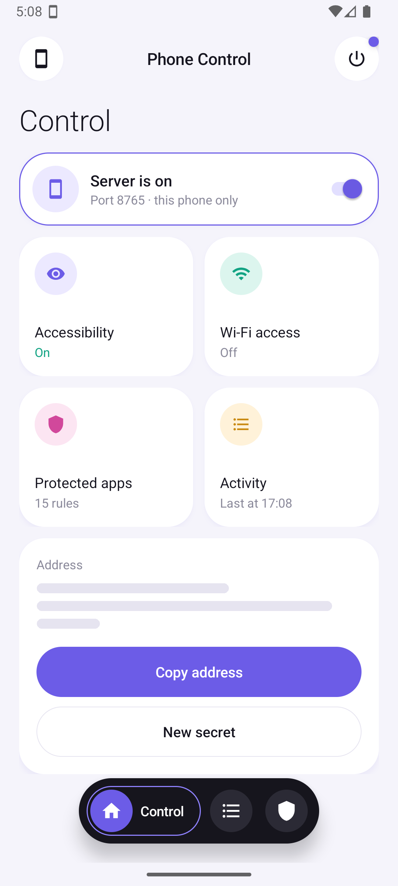

# Phone Control

Let Claude or ChatGPT operate your Android phone: see the screen, tap, swipe, type and open apps.
It runs on the phone itself, with no PC attached.



## How it works

```
Claude / ChatGPT  ──https──▶  tunnel (Termux)  ──▶  Phone Control app  ──▶  your phone
                                                     MCP server + accessibility service
```

- An **accessibility service** takes screenshots, performs gestures, enters text and reads the screen.
- A **foreground service** runs a small MCP server (Streamable HTTP) on port 8765.
- A **tunnel** (Termux + cloudflared) gives it a public address that AI apps can reach.

## Quick start

**1. Install the app.** Requires Android 11 or newer.

```bash
cd app-standalone
gradlew assembleDebug
adb install -r app/build/outputs/apk/debug/app-debug.apk
```

**2. Turn it on.** Open Phone Control, tap **Accessibility** and enable the service, then switch the
server on. On Android 13+, first allow restricted settings from the app's App info page.

**3. Get a public address.** Install [Termux](https://github.com/termux/termux-app/releases) from
GitHub, then:

```bash
pkg install cloudflared
cp termux/tunnel $PREFIX/bin/tunnel && chmod +x $PREFIX/bin/tunnel
echo "<secret from the app's address>" > ~/.phonecontrol_secret
tunnel
```

It prints the address to paste into your AI app as a custom MCP connector. The address changes on every start.

## Tools

`phone_info` · `screenshot` · `read_screen` · `tap` · `long_press` · `swipe` · `type_text` ·
`press_key` · `open_app` · `list_apps` · `open_url` · `wait`

Coordinates are pixels in the latest screenshot (long side 1344 px). `type_text` handles any language and
emoji. `open_app` matches app names and package names.

## Safety

- **Secret address.** The URL contains a random secret; a wrong one gets a 404. Anyone who has the full
  address can operate the phone, so treat it like a password. **New secret** in the app replaces it.
- **Protected apps.** Taps, swipes and typing are refused while a banking, UPI or wallet app is on
  screen. The word and package lists are editable in the app.
- **Visible and stoppable.** A notification with a Stop button stays up while the server runs.
- **Logged.** Every action appears in the app's Activity tab.
- **Local by default.** The server listens on the phone only, unless you allow Wi-Fi access in the app.

## Status

Tested on an Android 16 emulator and installed on an Android 12 phone. The tools and the public
address work when called from a PC. Connecting from the Claude app currently fails at the sign-in step,
and ChatGPT is untested. No release builds yet, so build the debug APK yourself.

## Repository

| Path | What |
| --- | --- |
| `app-standalone/` | The Android app (Kotlin) and its [notes](app-standalone/README.md) |
| `app-standalone/termux/tunnel` | Tunnel script for Termux |
| `docs/adb-server.md` | The earlier PC version: [`server.py`](server.py) drives the phone over adb |
| `ad/` | Remotion project for the promo video |

## License

No license yet. All rights reserved until one is added.
